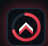

<div align="center">



# VALORANT RANK OVERLAY


### A live rank-tracking overlay for OBS Studio

**Created by IMX DemonBoy**

<a href="https://www.youtube.com/@imxdemonboy010" title="YouTube">
  
</a>
&nbsp;&nbsp;
<a href="https://kick.com/demonboy010" title="Kick">
  
</a>
&nbsp;&nbsp;
<a href="https://www.instagram.com/imxdemonboy_official/" title="Instagram">
  
</a>


[](https://developer.mozilla.org/en-US/docs/Web/HTML)
[](https://developer.mozilla.org/en-US/docs/Web/CSS)
[](https://developer.mozilla.org/en-US/docs/Web/JavaScript)

---

**Choose a design. Customize your stats. Take your rank on stream.**

</div>

## Overview

A single-file setup page that generates a customizable **live VALORANT rank overlay** for OBS. Choose a style, enter your account details, customize the display and effects, preview the result, and download a ready-to-use `overlay.html`.

## Features

| Feature | Description |
|---|---|
| **14 overlay styles** | Classic Card, Slim Bar, Glass, Neon Terminal, Tactical HUD, Ring Badge, Wide Banner, Minimal Text, Red Slash, Retro Arcade, Aurora Glass, Frosted Glass, Holo Glass and Crystal |
| **Rank and RR tracking** | Display your current rank, RR number and RR progress |
| **Match information** | Show the last match result, RR change and last five match results |
| **Session statistics** | Display session RR, match record and win/loss streak |
| **Peak rank rotation** | Switch between current rank and a full peak-rank view |
| **Full customization** | Adjust colours, text, panel, transparency, font, corners and size |
| **Visual effects** | Glow, shimmer, sparks, scanlines, floating rank icon, RR animation, rank-up banner and more |
| **Demo mode** | Simulate wins, losses and rank changes to test the overlay |
| **Automatic refresh** | Configure data refresh from 5 to 15 seconds |
| **OBS support** | Add the generated file as a local Browser Source |

## Requirements

- OBS Studio (or streaming software with a Browser Source)
- A free HenrikDev API key
- Your VALORANT Riot ID (name and tag)

## Getting started

1. Download the setup HTML file from this repository: **`Rank_Overlay by DemonBoy.html`**.
2. Open the file in a browser directly from your PC. Do not use an online or chat preview; the page needs to run locally to contact the API.
3. Choose one of the 14 overlay styles.
4. Enter your HenrikDev API key, Riot name, tag, region and platform.
5. Customize the information, colours, transparency and effects.
6. Check the preview and select **Download my overlay.html**.

### Add the overlay to OBS

1. Open OBS Studio.
2. Add a **Browser** source to your scene.
3. Enable **Local file** and select your downloaded `overlay.html`.
4. Set the width and height shown on the setup page.
5. Save your source. The overlay refreshes automatically.

If you change your design or settings, generate and download a new `overlay.html` file.

## Supported regions

| Region code | Area |
|:---:|---|
| `ap` | Asia Pacific (India, Japan, Southeast Asia and Oceania) |
| `eu` | Europe |
| `na` | North America, Brazil and LATAM |
| `kr` | Korea |

## Keep your API key private

> [!CAUTION]
> The generated `overlay.html` contains your HenrikDev API key. **Do not publish, share, commit or display that generated file on stream.**

The setup page in this repository does not contain your personal API key and is safe to share.

Keep this entry in your `.gitignore`:

```gitignore
overlay.html
```

## Data source

Rank and match information is provided by the [HenrikDev VALORANT API](https://docs.henrikdev.xyz/).

## Connect with IMX DemonBoy

Follow for streams, project updates and gaming content.

<div align="center">
  <a href="https://www.youtube.com/@imxdemonboy010" title="YouTube">
    
  </a>
  &nbsp;&nbsp;&nbsp;
  <a href="https://kick.com/demonboy010" title="Kick">
    
  </a>
  &nbsp;&nbsp;&nbsp;
  <a href="https://www.instagram.com/imxdemonboy_official/" title="Instagram">
    
  </a>
</div>

## Credits and disclaimer

**Created by IMX DemonBoy.**

This is an independent community project. It is not affiliated with, endorsed by, or sponsored by Riot Games. VALORANT and all related names and assets are trademarks of Riot Games, Inc.

---

<div align="center">


<a href="https://github.com/DemonBoy010" title="Visit IMX DemonBoy on GitHub">
  
</a>

**IMX DemonBoy** · [GitHub](https://github.com/DemonBoy010)

</div>
